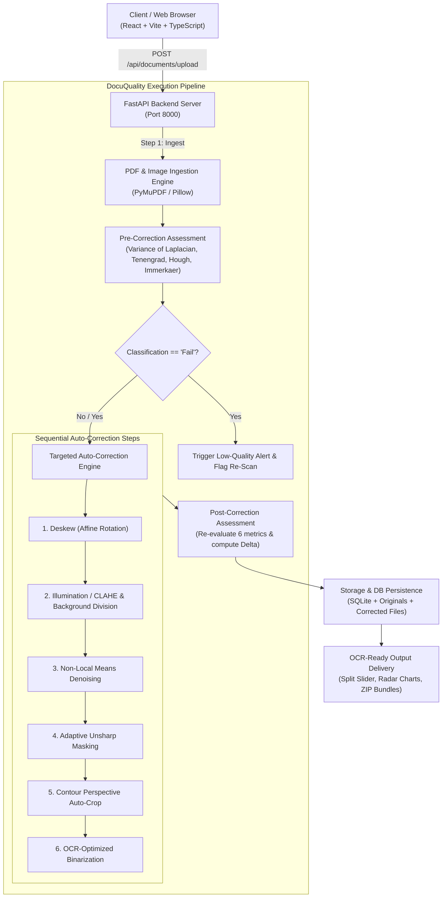

# DocuQuality: Document Image Quality Assessment & Auto-Correction System

[](https://www.python.org/)
[](https://fastapi.tiangolo.com)
[](https://opencv.org/)
[](https://react.dev/)
[](https://vitejs.dev/)
[](https://tailwindcss.com/)

Organizations rely heavily on scanned and mobile-captured document images for archiving, compliance, and automated OCR pipelines. Roughly **30% fail OCR or demand expensive re-scans** due to motion blur, orientation skew, uneven lighting/shadows, and sensor noise.

**DocuQuality** solves this problem by automatically assessing every uploaded document image against objective computer vision metrics, applying targeted corrections only for the specific defects detected, and delivering OCR-ready documents with an interactive before/after comparison.

---

## Architecture Diagram



---

## 6 Objective Quality Assessment Metrics

All metrics are evaluated on a grayscale copy and normalized to an objective **0–100 sub-score**:

1. **Blur / Sharpness**:
   - Computes the **Variance of Laplacian** ($\sigma^2$) and **Tenengrad Sobel gradient energy**.
   - Low variance indicates blurred text character glyphs.
2. **Orientation & Skew**:
   - Detects text baseline angles via **Probabilistic Hough Line Transform** and binary text coordinate `minAreaRect`.
   - Sub-score drops as absolute tilt angle $|\theta|$ deviates from $0.0^\circ$.
3. **Brightness & Illumination Uniformity**:
   - Evaluates overall mean intensity and detects cast shadows or uneven vignetting via a **$4 \times 4$ block grid intensity variance**.
4. **Dynamic Range & Contrast**:
   - Evaluates standard deviation ($\sigma$) and the **5th–95th percentile dynamic intensity span**.
5. **Noise & Sensor Grain**:
   - Estimates noise standard deviation ($\sigma_n$) using the **Immerkaer Laplacian kernel filter** combined with median filter residuals.
6. **Resolution & Estimated DPI**:
   - Computes pixel dimensions and calculates estimated DPI based on standard document page dimensions (e.g. A4 width $8.27''$). Flagged as low if $< 150$ DPI and optimal if $\ge 300$ DPI.

### Overall Score & Classification Tiers
- **Overall Score (0–100)**: Configurable weighted average (default: Blur 0.25, Skew 0.15, Brightness 0.15, Contrast 0.15, Noise 0.15, Resolution 0.15).
- **Pass (Green)**: Score $\ge 75$ and no individual metric sub-score $< 50$.
- **Needs Correction (Amber)**: Score $45 - 74$ or any sub-score $< 50$.
- **Fail (Red)**: Score $< 45$. Severe degradation; flagged for manual re-scanning.

---

## Auto-Correction Engine

Corrections are applied in a strict, targeted non-destructive sequence:
1. **Deskew**: Affine rotation by estimated $-\theta$ with white margin border fill.
2. **Illumination / Shadow Normalization**: CLAHE on the L channel of LAB color space, large-kernel Gaussian background division to eradicate cast shadows, and gamma adjustment for exposure.
3. **Denoise**: OpenCV `fastNlMeansDenoising` scaled to the estimated noise sigma.
4. **Sharpen**: Unsharp masking with strength inversely proportional to blur variance (avoids halo artifacts).
5. **Contour Auto-Crop**: Detects 4-corner polygon document boundary and perspective-transforms the page.
6. **Optional Binarization**: Adaptive Gaussian thresholding for high-contrast OCR output.

---

## Quickstart & Local Setup

### Prerequisites
- Python 3.11+
- Node.js 18+ and npm

### 1. One-Command Setup via Make
```bash
# Install dependencies, generate sample documents, and run tests
make install
make sample-data
make test

# Launch both backend and frontend servers
make dev
```

### 2. Manual Setup

#### Backend Setup
```bash
cd backend
python -m pip install -r requirements.txt
python generate_samples.py
python -m pytest tests -v
python -m uvicorn backend.app.main:app --host 127.0.0.1 --port 8000 --reload
```
FastAPI interactive Swagger documentation will be live at `http://127.0.0.1:8000/docs`.

#### Frontend Setup
```bash
cd frontend
npm install
npm run dev
```
Open your browser at `http://localhost:5173`.

### 3. Docker Compose
Run the entire production-grade stack with one command:
```bash
docker-compose up --build
```
Access the application at `http://localhost:5173`.

---

## API Reference Overview

| Method | Endpoint | Description |
|---|---|---|
| `POST` | `/api/documents/upload` | Upload single or batch files (up to 50 files, 25MB each) |
| `GET` | `/api/documents/{id}` | Retrieve complete before/after scores, defects, and image URLs |
| `GET` | `/api/documents` | Paginated document list with status, score, and search filters |
| `GET` | `/api/documents/{id}/download` | Download corrected image, original, or ZIP package |
| `GET` | `/api/documents/batch/{id}/zip` | Download all corrected documents in a batch as a ZIP |
| `POST` | `/api/documents/{id}/reprocess` | Fine-tune correction toggles and strengths |
| `DELETE` | `/api/documents/{id}` | Remove document and associated disk artifacts |
| `GET` | `/api/analytics/summary` | Aggregate KPI counts, pass rates, and defect distribution |
| `GET` | `/api/analytics/trends` | Historical quality scores over time |
| `GET` | `/api/alerts` | Critical quality alerts for failed scans |
| `GET/PUT` | `/api/settings` | Read and tune metric weights, thresholds, and defaults |

---

## Automated Test Suite

Run unit tests asserting that synthetic degraded images (blurred, skewed, dark, noisy) are properly diagnosed and that post-correction scores exceed pre-correction scores:

```bash
python -m pytest backend/tests -v
```
All 11 unit tests pass verifying:
- Blur Laplacian variance degradation and unsharp mask recovery
- Hough line skew estimation and deskew angle alignment
- Shadow block spread detection and illumination normalization
- Noise sigma estimation and NL-Means filtering
- End-to-end delta improvement assertion (`after_score >= before_score`)
