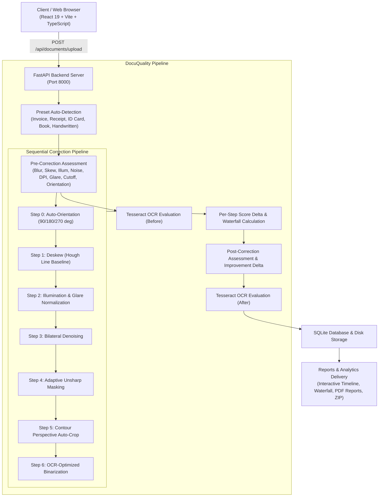

# DocuQuality: Document Image Quality Assessment & Auto-Correction System

[](https://www.python.org/)
[](https://fastapi.tiangolo.com)
[](https://opencv.org/)
[](https://github.com/tesseract-ocr/tesseract)
[](https://react.dev/)
[](https://vitejs.dev/)
[](https://tailwindcss.com/)
[](backend/tests)

Organizations rely heavily on scanned and mobile-captured document images for archiving, compliance, and automated OCR pipelines. Roughly **30% fail OCR or demand expensive re-scans** due to motion blur, orientation skew, uneven lighting/shadows, and sensor noise.

**DocuQuality** solves this problem by automatically assessing every uploaded document image against objective computer vision metrics, applying targeted corrections only for the specific defects detected, and delivering OCR-ready documents with an interactive before/after comparison and explainable score waterfall.

---

## 🌟 Advanced Features

### 1. OCR Accuracy Proof
- **End-to-End Tesseract Integration**: Measures word confidence and word count before vs. after restoration.
- **Graceful Degradation**: Controlled via `ENABLE_OCR` and `TESSERACT_CMD` environment variables; degrades smoothly if Tesseract is not installed without crashing.
- **OCR Readiness Card**: Displays mean word confidence before vs. after, recovered words counter, side-by-side extracted text diff with highlighted additions, and a "Copy Text" button.
- **Analytics KPIs & Trend Chart**: Tracks average OCR confidence gains and recovered word counts across processing batches.
- **Automated Benchmark Suite**: Run `python backend/benchmark_ocr.py` to evaluate OCR accuracy across clean, blurred, skewed, and noisy document images, producing a benchmark report and CSV log.

### 2. Defect Diagnosis & Rescan Guidance
- **Specular Glare & Hotspot Detection**: Flags washouts, flash reflections, and over-saturation where text ink is destroyed.
- **Page-Edge Cut-Off Detection**: Analyzes 5% edge boundaries to detect cut-off headers, cropped barcodes, and missing page borders.
- **90° / 180° / 270° Orientation Detection**: Word contour morphological aspect-ratio profiling accurately identifies upside-down or sideways pages.
- **Step 0 Auto-Orientation**: Corrects coarse orientation (90°/180°/270°) prior to fine-grain deskewing.
- **Actionable Rescan Guidance**: Provides step-by-step physical capture advice (e.g., "Step back and zoom in to avoid phone shadows", "Turn off camera flash and use diffuse lighting").

### 3. Document-Type Presets & Auto-Classification
- **6 Built-in Presets**:
  - `General`: Standard business letters and contracts.
  - `Invoice`: Form structure and tabular line-item weighting.
  - `Receipt`: High-contrast tuning for faint thermal receipt paper.
  - `ID Card`: Emphasizes fine-detail sharpness for micro-print and security patterns.
  - `Book Page`: Accommodates gutter contrast and curved text baselines.
  - `Handwritten Note`: Gentle denoise to protect cursive pencil/pen strokes.
- **Heuristic Auto-Detection**: Inspects aspect ratio, table rule counts, color distribution, and gutter contrast to detect document types automatically upon upload.
- **Preset Editor in Settings**: Fine-tune metric weights, thresholds, and correction toggles per preset.

### 4. PDF Quality Audit Reports
- **Single-Document Quality Report** (`/api/documents/{id}/report`):
  - Branded, multi-page vector PDF generated via `reportlab`.
  - Document metadata, overall quality badge, and status classification.
  - Before vs. after visual thumbnail comparisons.
  - Complete 8-metric diagnostic table with raw values and sub-scores.
  - Actionable physical capture tips and applied corrections summary.
  - OCR extraction readiness card and recognized text snippet.
  - Two-pass `NumberedCanvas` footer with "Page X of Y" and timestamp.
- **Batch Audit Report** (`/api/documents/batch/{id}/report`):
  - Aggregate executive summary for entire multi-file uploads.
  - Pass / Needs Review / Fail breakdown, average quality scores, and OCR gains.
  - Comprehensive document audit log table.

### 5. User Feedback Loop & Adaptive Calibrations
- **Document Rating Widget**: Rate corrections with Thumbs Up or Thumbs Down, select specific disliked steps (Deskew, Illumination, Denoise, Sharpen, Binarization), and provide free-form feedback.
- **User Satisfaction Analytics**: Real-time satisfaction rate %, approval vs. tune-request progress bar, most frequently downvoted correction steps, and recent operator comments.
- **Adaptive Settings Suggestions**: Intelligent engine analyzes negative ratings and document failure rates to suggest parameter calibrations (e.g., "Lower CLAHE clip limit to 1.5 to reduce contrast artifacts", "Calibrate mobile blur threshold to 40.0"). Includes one-click **"Apply Suggestion"** buttons.

### 6. Explainability Polish & Score Waterfall
- **Per-Step Delta Attribution**: Calculates intermediate quality scores after each applied correction step to determine exact mathematical score improvement ($\Delta$).
- **"What We Fixed and Why" Timeline**: Replaces plain lists with an interactive sequence showing step name, original defect detected with severity, corrective algorithm executed, and score delta (+12 pts, etc.).
- **Recharts Waterfall Progression Chart**: Visualizes score progression from Raw Input Score &rarr; Step 1 &rarr; Step 2 &rarr; Final Delivered Score.

---

## 🏗️ Architecture



---

## 🛠️ Installation & Quickstart

### Prerequisites
- Python 3.11+
- Node.js 18+ and npm
- *(Optional)* Tesseract OCR for text extraction verification

### Installing Tesseract OCR (Optional)
DocuQuality works completely without Tesseract (degrading gracefully with status messages). To enable OCR features:

- **Windows**:
  ```powershell
  # Using winget
  winget install UB-Mannheim.TesseractOCR
  
  # Or download installer from:
  # https://github.com/UB-Mannheim/tesseract/wiki
  ```
  Set in your `.env` or system environment:
  ```env
  ENABLE_OCR=true
  TESSERACT_CMD=C:\Program Files\Tesseract-OCR\tesseract.exe
  ```

- **macOS**:
  ```bash
  brew install tesseract
  ```

- **Linux (Ubuntu/Debian)**:
  ```bash
  sudo apt-get update && sudo apt-get install -y tesseract-ocr
  ```

---

### Backend Setup
```bash
# Navigate to project root
python -m pip install -r backend/requirements.txt

# Run full automated test suite (30 tests)
python -m pytest backend/tests -v

# Run OCR Accuracy Benchmark
python backend/benchmark_ocr.py

# Start FastAPI server
python -m uvicorn backend.app.main:app --host 127.0.0.1 --port 8000 --reload
```
Interactive API documentation will be live at `http://127.0.0.1:8000/docs`.

---

### Frontend Setup
```bash
cd frontend
npm install

# Run frontend test build
npm run build

# Start Vite dev server
npm run dev
```
Open your browser at `http://localhost:5173`.

---

## 🧪 Automated Test Suite (30/30 Passing)

| Test Module | Coverage |
|---|---|
| `backend/tests/test_assessment.py` | Clean docs, blur variance, Hough line skew, shadows, noise, DPI estimation |
| `backend/tests/test_correction.py` | Deskew, illumination normalization, denoise, sharpen, end-to-end delta improvement |
| `backend/tests/test_defect_guidance.py` | Glare/hotspot detection, page-edge cut-off, 90°/180° orientation, rescan guidance tips |
| `backend/tests/test_presets.py` | Built-in presets structure, config override application, receipt/invoice/ID card heuristic detection |
| `backend/tests/test_report.py` | ReportLab single document branded PDF generation and batch audit report generation |
| `backend/tests/test_feedback.py` | Rating submission, feedback retrieval, satisfaction analytics, adaptive suggestions engine |
| `backend/tests/test_explainability.py` | Per-step intermediate score delta calculation, waterfall progression, and detail serialization |

Run all tests:
```bash
python -m pytest backend/tests -v
```

---

## 📡 Key API Endpoints

| Method | Endpoint | Description |
|---|---|---|
| `POST` | `/api/documents/upload` | Upload single or batch files with preset selector |
| `GET` | `/api/documents/{id}` | Complete document record, OCR readiness, and explainability timeline |
| `GET` | `/api/documents` | Paginated document list with status, score, and preset filters |
| `POST` | `/api/documents/{id}/feedback` | Submit operator rating (thumbs up/down), disliked steps, and comments |
| `GET` | `/api/documents/{id}/report` | Download branded single-document PDF Quality Audit Report |
| `GET` | `/api/documents/batch/{id}/report` | Download batch summary PDF Audit Report |
| `GET` | `/api/documents/{id}/download` | Download original, corrected, or ZIP package |
| `POST` | `/api/documents/{id}/reprocess` | Fine-tune correction toggles and rerun pipeline |
| `GET` | `/api/analytics/summary` | Aggregate KPI counts, pass rates, and OCR gains |
| `GET` | `/api/analytics/trends` | Historical quality scores and OCR trends over time |
| `GET` | `/api/analytics/feedback` | User satisfaction rate, thumbs count, and most disliked steps |
| `GET` | `/api/settings/suggestions` | Feedback-driven adaptive calibration suggestions |
| `POST` | `/api/settings/suggestions/apply` | Apply suggested threshold or pipeline tweak |
| `GET` | `/api/settings/presets` | List all document presets |
| `PUT` | `/api/settings/presets/{id}` | Update preset metric weights, thresholds, and correction defaults |
